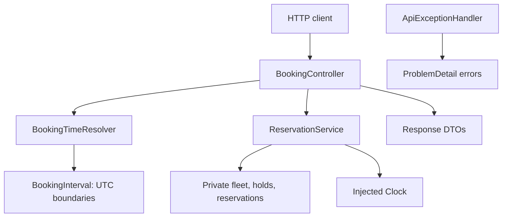

# Car rental simulation

A Java 25 / Spring Boot simulation of a limited car-rental fleet.
A REST API supports browsing availability, placing temporary holds, and confirming
reservations. State is in memory and is lost when the application restarts.

## Run

Install JDK 25. Maven is supplied by the checked-in Maven Wrapper:

```sh
./mvnw clean verify
./mvnw spring-boot:run
```

On Windows, use `mvnw.cmd`. The first run downloads Maven and dependencies.
`clean verify` compiles for Java 17, runs the tests, and builds an executable JAR.
To run that artifact instead of using the Spring Boot Maven plugin:

```sh
java -jar target/car-rental-0.0.1-SNAPSHOT.jar
```

For a faster test-only run, use `./mvnw test`.

## Agreed requirements

- Customers request a sedan, SUV, or van from a finite fleet.
- Requests contain start and end dates, with optional times. Each omitted time
  defaults independently to 10:00 a.m. in America/New_York.
- Alternatively supply a positive integer `days` instead of `endDate`. Calendar
  days preserve local pickup time, even across daylight-saving changes.
  Do not combine `days` with `endDate` or `endTime`.
- The end must follow the start. Starts in the past are rejected.
- Booking intervals include their start and exclude their end: adjacent bookings
  can use the same car.
- An active temporary hold blocks overlapping bookings for its assigned car.
  A hold can be confirmed or released; it expires after a configurable TTL
  (five minutes by default). The sample fleet has two cars per type.
- Confirmation at or after expiration fails. Confirmed reservations do not expire.
  Repeated confirmation returns the same reservation; release is safe to repeat
  and never cancels an existing reservation.
- Ambiguous and nonexistent local times during daylight-saving changes are rejected.
- Checking availability and placing a hold must be atomic. The initial system
  runs in a single process with in-memory storage.
- No persistence, authentication, payments, or reservation cancellation initially.

## Design

- `CarType` is an enum: car categories have identical behavior today, so they do
  not need separate subclasses.
- `BookingInterval` is an immutable value object. It owns interval validation
  and overlap calculation, independent of Spring and HTTP.
- A Spring `Clock` bean supplies current time. Services receive it through
  constructor injection; tests control time without sleeping.
- UTC instants represent actual moments. The configured rental timezone will
  interpret customer inputs through `BookingTimeResolver`; it is separate from the clock.
- `ReservationService` owns a copied fleet and private in-memory maps. Its
  synchronized operations protect the complete check-and-update sequence.
  Expired holds are ignored during availability checks without a background job.
  They are retained to distinguish expired from unknown holds, so memory grows
  with usage; a production system needs persistence and a retention policy.
- `RentalConfiguration` wires service dependencies and configurable inventory.
  The domain and services have no Spring dependencies.



The resolver interprets the requested period; the service checks inventory and
changes booking state. Both the HTTP availability endpoint and hold creation
use the same availability rules. All state access occurs under the service's
monitor, including confirmation and release.

## Requirement coverage

| Requirement | Evidence |
| --- | --- |
| Reserve a type for a start and number of days | Resolver calendar-day tests; HTTP hold/confirmation workflow |
| Sedan, SUV, and van | Service type-isolation tests; HTTP availability counts |
| Finite inventory | Service fleet-exhaustion tests; HTTP 409 response |
| No conflicting reservations | Interval overlap cases; holds and confirmed reservations block inventory |
| Temporary checkout holds | Exact TTL-boundary, release, and confirmation tests |
| Concurrent requests cannot claim the same car | Two-worker last-car test with coordinated start |
| Date-only defaults and timezone handling | Resolver defaults and daylight-saving tests |
| Input validation and useful failures | HTTP malformed input, missing fields, past dates, unknown IDs, and conflicts |

## HTTP API

| Method | Path | Result |
| --- | --- | --- |
| GET | `/availability` | 200, counts for all three types, including zeros |
| POST | `/holds` | 201, hold ID, assigned car, interval, and expiration |
| POST | `/holds/{holdId}/confirm` | 200, reservation; safe to retry |
| DELETE | `/holds/{holdId}` | 204; safe to repeat, does not cancel reservations |

Dates use ISO `YYYY-MM-DD`, times use `HH:mm[:ss]`, and types are uppercase.
Availability accepts period fields as query parameters; hold creation accepts
JSON with those same fields plus `carType`. Date/time fields use the rental zone;
responses use UTC instants. Availability is a snapshot and does not claim a car.
A later hold request may fail if another caller takes the remaining inventory.

Start the application, then browse and create a hold (use future dates):

```sh
curl 'http://localhost:8080/availability?startDate=2030-06-01&days=2'
curl -X POST http://localhost:8080/holds \
  -H 'Content-Type: application/json' \
  -d '{"carType":"SEDAN","startDate":"2030-06-01","days":2}'
```

Example hold response (IDs and expiration vary):

```json
{
  "id": "08e3efb4-e17b-4e50-923a-dea262b0d466",
  "carId": "SEDAN-1",
  "carType": "SEDAN",
  "start": "2030-06-01T14:00:00Z",
  "end": "2030-06-03T14:00:00Z",
  "expiresAt": "2026-10-16T22:05:00Z"
}
```

Use the returned hold ID to confirm or release:

```sh
curl -X POST http://localhost:8080/holds/REPLACE_WITH_HOLD_ID/confirm
curl -X DELETE http://localhost:8080/holds/REPLACE_WITH_HOLD_ID
```

For an explicit return time, replace `days` with `endDate` and optionally `endTime`:

```json
{
  "carType": "SUV",
  "startDate": "2030-06-01",
  "startTime": "12:00",
  "endDate": "2030-06-03",
  "endTime": "16:00"
}
```

Errors use Spring `ProblemDetail` JSON with `status`, `detail`, and `code`:

| Status | Code | Meaning |
| --- | --- | --- |
| 400 | INVALID_REQUEST | Missing, malformed, contradictory, or invalid period input |
| 400 | START_IN_PAST | Booking start has already passed |
| 404 | HOLD_NOT_FOUND | Unknown or released hold |
| 409 | UNAVAILABLE | No car of the requested type is free for the entire period |
| 409 | HOLD_EXPIRED | Hold reached its expiration instant |

`BookingController` delegates to the services. Request and response DTOs keep
JSON binding separate from immutable domain objects. The request DTO is mutable
for Spring binding; response DTOs are immutable and expose explicit getters.
`ApiExceptionHandler` maps failures to consistent HTTP errors.

Configure timezone, hold TTL, and per-type fleet sizes in
`src/main/resources/application.properties`. Synchronized operations protect a
single service instance. Multiple application instances would require shared
storage and atomic coordination across instances.

Service tests cover hold expiration boundaries, repeat confirmation, release,
inventory exhaustion, past starts, and concurrent competition for the last car.
